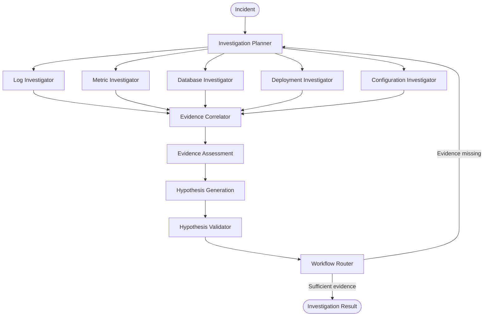

# RootNexus

> Agentic incident investigation system that analyzes operational evidence and iteratively investigates the root cause of production incidents.

## What it does

RootNexus uses a graph-based multi-agent workflow to investigate incidents by combining logs, metrics, deployments, database evidence, and configuration information.

The system generates hypotheses, assesses available evidence, validates hypotheses, and routes the investigation toward additional evidence when required.

## Architecture



## Key Components

### Multi-Agent Investigation

Uses specialized agents for different evidence sources, including logs, metrics, databases, deployments, and configuration.

### Investigation Planning

The planner determines which investigative tasks are required and coordinates the investigation workflow.

### Evidence Correlation

Combines findings from different investigators to identify relationships and correlations across operational signals.

### Hypothesis Generation

Builds candidate root-cause hypotheses from the available evidence and records supporting or contradicting signals.

### Evidence Assessment

Evaluates whether the collected evidence is sufficient, considering factors such as coverage, consistency, temporal correlation, and causal support.

### Hypothesis Validation

Validates proposed hypotheses and identifies missing evidence when confidence is insufficient.

### Graph-based Workflow

The investigation is orchestrated as a stateful graph with routing and iterative investigation paths. 

## Project Structure

```text
RootNexus/
├── agents/
│   ├── planner.py
│   ├── log_investigator.py
│   ├── metric_investigator.py
│   ├── database_investigator.py
│   ├── deployment_investigator.py
│   ├── configuration_investigator.py
│   ├── correlator.py
│   ├── evidence_assessment.py
│   ├── hypothesis.py
│   └── validator.py
│
├── graph/
│   ├── state.py
│   ├── workflow.py
│   ├── router.py
│   └── barrier.py
│
├── schemas/
├── utils/
├── main.py
├── pyproject.toml
└── README.md
```

## Tech Stack

- Python
- LangGraph
- LangChain
- Pydantic
- LLM-based agents

## Getting Started

```bash
git clone https://github.com/AyushhVatsal/RootNexus.git
cd RootNexus

uv sync
uv run python main.py
```

## Current Status

### Completed

- Multi-agent investigation workflow
- Investigation planning
- Log investigation
- Metric investigation
- Database investigation
- Deployment investigation
- Configuration investigation
- Evidence correlation
- Evidence assessment
- Hypothesis generation
- Hypothesis validation
- Graph-based routing

### Roadmap

- Connect to real observability systems
- Add persistent investigation history
- Improve evidence retrieval
- Add richer incident reports
- Add production monitoring integrations

## License

MIT
